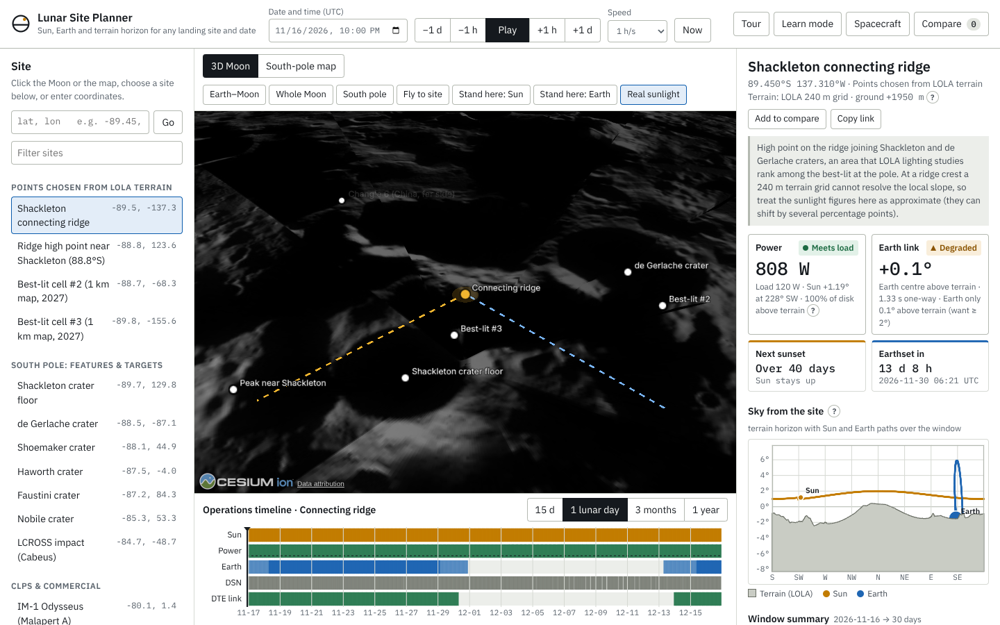

# Lunar Site Planner

A browser tool for comparing lunar landing sites and dates. For any point on the Moon and any UTC date it shows where the Sun and Earth sit relative to the local terrain horizon, estimates solar-array output, and checks whether a direct-to-Earth radio link is possible. It was built for the NASA Space Apps Challenge 2026, *CLPS Lunar Mission Browser*.



Live site: published by GitHub Pages from `main` (see [Deployment](#deployment)).

## Quick start

```bash
npm install
npm run dev          # http://localhost:5174
```

```bash
npm test             # unit tests (geometry, terrain, power, comms, comparison)
npm run build        # static site in dist/
```

No API keys are needed: terrain, imagery, fonts and ephemerides all work offline. An optional [Cesium ion](https://ion.cesium.com/tokens) token (in `.env` as `VITE_CESIUM_ION_TOKEN=...`, or under **Spacecraft**) adds Cesium Moon Terrain tiles and NASA's Artemis candidate landing regions as visual layers. All numbers still come from the bundled LOLA grids.

New users are asked at start-up whether they want the **video tutorial**: a narrated, captioned walkthrough (about 3½ minutes, 11 chapters) built from screenshots of the real app. It can be reopened at any time with the amber **▶ Video tutorial** button in the top bar, and is also available as an [MP4 download](public/tutorial/lunar-site-planner-tutorial.mp4). **Tour** starts an interactive walkthrough that uses the real controls instead. The **?** buttons next to technical terms open short definitions.

## What it does

| Question | Where in the app |
|---|---|
| Which sites can I look at? | Site list (south-pole features, CLPS and other missions, Apollo, points chosen from LOLA terrain), a click on the 3D Moon or the south-pole map, or typed coordinates (`-89.45, -137.3` or `89.45S 137.3W`). |
| Where are the Sun and Earth from this site? | The sky plot draws the terrain skyline with the Sun and Earth paths over the analysis window. In 3D, the Moon is lit from the computed Sun direction, and "Stand here" views look along the Sun or Earth direction from mast height. |
| Is there power? | Array output against the continuous load, the visible fraction of the solar disk, time sunlit, longest darkness and an estimated battery size. |
| Can the lander talk to Earth? | Earth's clearance above the terrain, which Deep Space Network complexes can see the Moon, a first-order link budget, light time, and the next Earthset or Earthrise. |
| How do dates and sites compare? | The operations timeline (click, drag or use the arrow keys), and the comparison table with schedule slips of one to three lunar months and a search for better-lit points within 5 km. Results export to CSV and to shareable links. |

## How the numbers are made

All calculations run in the browser from pure functions in `src/core/`, shared by the interface, the tests and the offline tools.

- **Sun and Earth positions** come from [astronomy-engine](https://github.com/cosinekitty/astronomy), rotated into the Moon's body-fixed frame with the IAU/WGCCRE rotation model (including libration terms). Positions are topocentric.
- **Terrain horizons** are traced along 720 azimuths out to 300 km over LRO LOLA heights (a 240 m grid within 180 km of the pole and a 1 km grid to 75°S), including the Moon's curvature. Sites north of 75°S use a bare-sphere horizon, and the app says so.
- **Definitions.** "Time sunlit" and "Earth visible" count the time that any part of the Sun's or Earth's disk is above the terrain, the definition NASA Goddard uses for its polar illumination maps. A direct-to-Earth link additionally needs Earth's centre above the terrain, by a configurable clearance (default 2°). The 2027 map overlay shows the average visible fraction of the solar disk and the share of time Earth's centre is visible, and is labelled that way.
- **Power** = 1361 W/m² × (1 AU / r)² × visible fraction of the solar disk × panel incidence × area × efficiency. Battery size is the deepest cumulative energy deficit against the load. These are first-order estimates.
- **Communications** use a first-order link budget to a DSN 34 m antenna. The reported data rate is limited by both the link budget and an assumed maximum for the selected radio.

### Validation

- Unit tests check sub-Earth points, lunar obliquity, the polar stereographic projection, disk geometry, link budgets, DSN coverage, and physical cases: Shackleton's floor is permanently shadowed, Chang'e 4 never sees Earth, and Apollo 11 has two-week days.
- During a project audit (November 2026) the geometry was compared with NASA/JPL SPICE (DE421 ephemeris, Moon Mean-Earth frame): Sun and Earth directions agreed within 0.008°. The 18.6-year sunlight and Earth-visibility percentages were compared with NASA Goddard's PGDA polar illumination maps at 3,721 points: sunlight RMSE 4.2 percentage points (r = 0.96), Earth visibility RMSE 5.6 percentage points (r = 0.97). The reproduction scripts are not yet in this repository.

### Known limits

- The 240 m and 1 km grids smooth out features smaller than about 0.5–1 km. At ridge crests, sunlight percentages can shift by several percentage points, and longest-night values by days, depending on how the terrain right around the lander is treated. Real site selection uses 5–60 m terrain products.
- Terrain covers the south polar region to 75°S only.
- Power, battery and link values are first-order estimates. Relay satellites, other ground networks, landing slopes and hazards are not modelled.
- Coordinates marked "approximate" are feature centres or targets to about 0.1°. Apollo positions are LROC-surveyed (Wagner et al. 2017).

## Data and credits

- **LOLA RDR** laser altimetry (NASA GSFC, Lunar Reconnaissance Orbiter) and **LROC WAC** global and south-polar mosaics (NASA, GSFC, Arizona State University), via the USGS Astrogeology Analysis Ready Data archive (`s3://astrogeo-ard/moon/…`). Public domain.
- Earth texture: Natural Earth II tiles bundled with CesiumJS.
- Libraries: [CesiumJS](https://cesium.com/platform/cesiumjs/) (Apache-2.0), [astronomy-engine](https://github.com/cosinekitty/astronomy) (MIT). Fonts: IBM Plex Sans and IBM Plex Mono (SIL Open Font License), self-hosted through Fontsource.
- References: Mazarico et al. (2011), *Icarus* 211, 1066–1081; Archinal et al. (2018), *Celestial Mechanics and Dynamical Astronomy* 130:22; Kopp and Lean (2011), *Geophysical Research Letters* 38, L01706; Wagner et al. (2017), *Icarus* 283, 92–103.

## Reproducing the bundled data

```bash
pip install "laspy[lazrs]" requests numpy scipy rasterio pillow
python tools/build_polar_dem.py public/data      # LOLA grids (about 7 min)
python tools/build_imagery.py public/data        # LROC imagery
node tools/illumination_map.mjs 75 1 2027        # 2027 map overlay (about 7 min on 4 cores)
```

## Video tutorial

The player (`src/ui/videoTutorial.js`) plays the voice-over track and draws each frame from the current playback time: zooms, spotlights, the cursor and captions are computed from the narration timing, so seeking, speed changes and muting stay in sync. Without audio it runs on an internal clock with captions. Keys: Space play/pause, ←/→ 5 s, Shift+←/→ chapter, C captions, M voice, F full screen.

To change it, edit the narration and the on-screen directions in `src/ui/tutorial/script.json` (`shot`, `zoom`, `spot`, `cursor`, `click`, `label`, `card`), then rebuild the parts that changed:

```bash
pip install kokoro-onnx soundfile numpy           # offline neural text-to-speech
# kokoro-v1.0.int8.onnx and voices-v1.0.bin from github.com/thewh1teagle/kokoro-onnx/releases (model-files-v1.0)
python tools/tutorial/build_narration.py kokoro-v1.0.int8.onnx voices-v1.0.bin   # voice-over + timing.json

npm run build && npx vite preview --port 4174 &   # a static build, so edits don't reload the page mid-capture
npm run tutorial:shots                            # screenshots + control positions (after UI changes)
npm run tutorial:video                            # downloadable 720p MP4, about 10 MB (rebuild first so it uses the new shots)
```

## Tests

```bash
npm test                                         # unit tests
npm i --no-save playwright && npx playwright install chromium
npm run dev &                                    # in another terminal is fine too
npm run test:e2e                                 # browser checks of every control, the video tutorial, the tour and phone layout
```

## Deployment

The workflow in `.github/workflows/deploy.yml` runs the unit tests and publishes `dist/` to GitHub Pages on every push to `main`. Pull requests run the tests only. To enable it once: **Settings → Pages → Build and deployment → Source: GitHub Actions**.

## Layout

```
index.html, vite.config.js, package.json
src/core/      ephemeris, horizon (LOLA), power, comms, analysis, sites, geo
src/scene/     CesiumJS Moon scene
src/ui/        sky plot, timeline, polar map, results panel, comparison, glossary, tour,
               video tutorial player and start-up welcome (script, timing and shot positions in src/ui/tutorial/)
public/data/   LOLA grids, LROC imagery, 2027 map overlay
public/tutorial/  video tutorial screenshots, voice-over and MP4
tools/         data build scripts; tools/tutorial/ rebuilds the video tutorial
test/          unit tests and the browser end-to-end check
```
